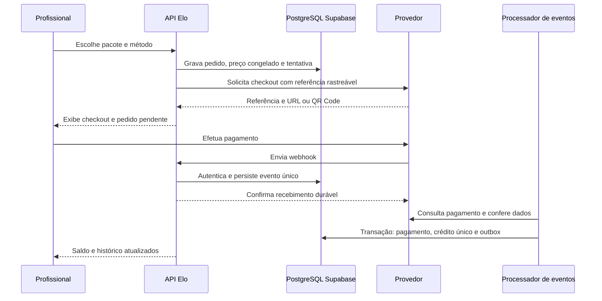

# Pagamentos do Elo: organização e funcionamento propostos

Estudo de 08/10/2026. Abrangência inicial: Palmas, Tocantins. Este documento é uma proposta de produto, arquitetura e operação; não representa contratação de provedor nem implementação de cobranças reais. A integração deve ser homologada no provedor e no PostgreSQL externo antes do lançamento.

## 1. Recomendação principal

Organizar pagamentos por finalidade, com um núcleo financeiro comum e regras próprias para cada produto:

| Finalidade | Quem paga | O que recebe | Quem recebe o dinheiro | Modelo recomendado |
| --- | --- | --- | --- | --- |
| Compra de moedas | Profissional | Créditos internos para desbloquear oportunidades | Elo | Venda de pacote, sem split |
| Serviço de Preço Fechado | Cliente | Serviço com escopo, profissional e preço definidos | Profissional e Elo | Checkout de marketplace com split contratado |
| Plano profissional, posteriormente | Profissional | Benefícios definidos e eventualmente créditos por ciclo | Elo | Assinatura com autorização explícita |

A publicação de pedidos de orçamento permanece gratuita para o cliente. Comprar moedas não garante contratação: remunera o acesso à oportunidade, conforme termos claros. O pagamento do serviço negociado fora do Elo permanece entre as partes, salvo futura adesão explícita ao checkout do Elo.

Proposta para moedas: créditos não transferíveis entre usuários e não sacáveis como dinheiro. Eventuais estornos de uma compra são processados como devolução daquela transação, e não como saque de carteira. A natureza contratual, contábil e regulatória desse desenho precisa ser validada; o nome "moeda" não resolve essas questões.

**Primeira entrega recomendada:** um provedor, Pix e cartão por checkout hospedado, compra de moedas, confirmação automática, devolução monetária, tratamento de contestações e conciliação. Checkout de serviços entra em uma entrega posterior, com onboarding dos recebedores e regras de execução do serviço.

## 2. O que o projeto já tem e o que falta

| Área | Situação atual | Complemento necessário |
| --- | --- | --- |
| Pacotes e compras | Pacotes, preço em centavos e pagamentos de demonstração | Checkout real, referência do provedor e tentativas |
| Carteira | Ledger imutável e saldo mantido por trigger | Origem dos créditos, reservas e reversões monetárias |
| Confirmação | Crédito idempotente no fluxo simulado | Autenticidade do evento e conferência no provedor |
| Desbloqueio | Transação, pedido antes do lead, quatro contatos e preço congelado | Preservar regras ao introduzir reservas de créditos |
| Reembolso | Devolução administrativa de moedas de um lead | Separar devolução de dinheiro, disputa e estorno de serviço |
| Preço Fechado | Adesão do profissional e catálogo público | Pedido de serviço, reserva, checkout, split e pós-venda |
| Banco | Supabase, schema privado e validação financeira externa | Novas migrations, privilégios e testes da integração |
| Administração | Visão básica de pagamentos pagos | Taxas, recebíveis, conciliação, divergências e caixa |

`DEMO_MODE=true` controla a simulação atual. Sem gateway configurado, a compra real é recusada. A tabela `payments` e a rotina `settlePayment` são uma base, mas ainda não constituem uma integração real. A soma de compras pagas no painel não demonstra lucro nem dinheiro liquidado no banco.

## 3. Métodos de pagamento

### Pix: prioridade inicial

- Criar cobrança identificada por pedido e tentativa, com QR Code dinâmico e Pix Copia e Cola gerados pelo provedor.
- Mostrar valor, beneficiário, vencimento e botão para consultar o pagamento. Manter a cobrança recuperável no histórico caso a página seja fechada.
- Liberar moedas somente após confirmação verificável no servidor; comprovante enviado pelo usuário e redirecionamento do navegador não autorizam crédito.
- Após expiração, conferir o provedor antes de emitir outra tentativa. Recebimento tardio verdadeiro precisa ser conciliado e resultar em entrega ou devolução conforme política previamente informada.
- Se duas tentativas forem pagas, entregar o pedido uma vez e abrir devolução do excedente. Uma segunda compra exige uma intenção de compra própria.

### Cartão: prioridade inicial

- Começar com checkout hospedado pelo provedor. Elo transmite o pedido e acompanha seu resultado.
- Exibir preço total e condições antes do encaminhamento. Parcelamento entra apenas com custos, valor mínimo e responsabilidade pelos juros definidos.
- Cartão salvo deve usar recurso/token do provedor com autorização do titular. Elo não deve receber PAN completo ou CVV.
- Tratar análise de risco, autorização, captura, recusa e contestação como fatos diferentes. Uma autorização isolada não entrega moedas.
- Comprar moedas com cartão capturado antes da liquidação bancária é uma decisão de risco: permite uso imediato, mas exige caixa para estornos e contestações.

Checkout hospedado reduz a exposição aos dados do cartão, mas o site do lojista ainda pode integrar o escopo PCI DSS. A avaliação aplicável deve ser confirmada com o provedor/adquirente. [PCI SSC](https://www.pcisecuritystandards.org/faqs/is-a-merchant-website-still-in-scope-for-pci-dss-if-it-meets-all-the-criteria-for-saq-a/).

### Boleto: expansão por demanda

Considerar quando houver demanda profissional que justifique pagamento assíncrono. Mostrar vencimento e processamento pendente; não desbloquear contatos enquanto não houver confirmação. Evitar reservar uma oportunidade disputada durante dias apenas porque um boleto foi emitido.

### Assinaturas e Pix Automático: expansão posterior

Um plano deve definir ciclo, benefícios, créditos, renovação, cancelamento, inadimplência e reajustes. Criar cada fatura como uma obrigação própria e entregar os benefícios uma única vez por ciclo. Não reaproveitar um Pix avulso como autorização de débito recorrente: Pix Automático depende de autorização do pagador. [Banco Central](https://www.bcb.gov.br/pix-automatico).

## 4. Escolha do provedor

| Opção | Aplicação considerada | Ponto decisivo para contratação |
| --- | --- | --- |
| Asaas | Candidato inicial para cobranças e evolução para split | Aceitação da venda de créditos internos, checkout, taxas, risco, subcontas e condições de repasse |
| Mercado Pago | Alternativa para checkout de moedas e marketplace | Jornada de vendedores, comissão, escopo do split e atendimento da conta |
| Pagar.me | Candidato para operação de marketplace | Adquirência habilitada, recebedores, contrato e capacidade operacional |

Asaas documenta contas destinatárias e split sobre o valor líquido. Mercado Pago documenta checkout hospedado ou integrado para marketplace. Pagar.me documenta recebedores e condiciona split à configuração de adquirência Pagar.me. [Asaas](https://docs.asaas.com/docs/split-de-pagamentos), [Mercado Pago](https://www.mercadopago.com.br/developers/pt/docs/checkout-api-payments/how-tos/integrate-marketplace?scope=prod), [Pagar.me](https://docs.pagar.me/reference/recebedores-1).

**Recomendação técnica preliminar:** avaliar primeiro Asaas para o fluxo de moedas; manter um adaptador para evitar dependência espalhada pelo código. Esta preferência é uma inferência de adequação funcional, condicionada à aprovação comercial do modelo e à homologação. Se essas condições não forem atendidas, comparar Mercado Pago e Pagar.me com os mesmos critérios.

Solicitar proposta escrita com: tarifa percentual/fixa por método, parcelamento, antecipação, liquidação, estorno, contestação, split, transferência, reserva de risco, limites, suporte e disponibilidade das APIs. Não escolher pelo percentual anunciado isoladamente. Não assumir que uma API documentada esteja liberada para a conta contratada.

Não começar com roteamento automático entre dois provedores: uma requisição que sofreu timeout pode ter gerado cobrança. Trocar imediatamente de gateway pode cobrar duas vezes.

## 5. Organização dos módulos

Manter o monólito NestJS organizado em módulos; não há necessidade inicial de microsserviços.

| Módulo | Responsabilidade |
| --- | --- |
| `catalog/pricing` | Pacotes, ofertas, promoções e versões de preços |
| `billing` | Intenção de compra, pedido comercial e tentativas |
| `payments` | Adaptador de gateway e normalização de estados |
| `webhooks` | Autenticação, persistência e processamento de eventos |
| `wallet` | Ledger de moedas, lotes, consumo e reservas |
| `bookings` | Contratação e execução de Preço Fechado |
| `recipients` | Cadastro e habilitação de recebedores |
| `refunds/disputes` | Devoluções, contestações e evidências |
| `settlements` | Recebíveis, split, repasses e conciliação |
| `finance-admin` | Operação, aprovações e relatórios |

O adaptador pode expor `createCheckout`, `getPayment`, `verifyWebhook`, `requestRefund`, `cancelPayment` e `listSettlements`. Recursos opcionais, como captura, parcelamento ou repasse programado, devem ter capacidades explícitas. Não simular uma funcionalidade que o provedor não oferece.

Regras de moedas ficam no Elo. Identificadores e estados originais do provedor ficam preservados para rastreabilidade. Chamadas externas não acontecem dentro de transações PostgreSQL que seguram locks.

## 6. Fluxo completo de compra de moedas

Passos e garantias:

1. API autentica o profissional e confere elegibilidade. Preço e moedas vêm do catálogo no servidor.
2. Pedido congela pacote, moedas pagas/bonificadas, preço, desconto, moeda BRL e versão dos termos. Uma alteração posterior no catálogo não modifica a compra.
3. Chave idempotente é vinculada ao usuário, finalidade e conteúdo. Mesma chave com conteúdo diferente retorna conflito.
4. Pedido e tentativa são persistidos antes da chamada externa. Um worker/outbox ou fluxo equivalente recuperável impede que a queda do processo esqueça a solicitação.
5. Adaptador usa idempotência do provedor quando documentada para o endpoint. Em resultado desconhecido, consulta por referência ou encaminha para conciliação; não pressupõe suporte universal a um header.
6. Navegador apresenta o checkout. A página de retorno consulta o Elo e pode mostrar "Estamos confirmando seu pagamento".
7. Evento autenticado é gravado antes do HTTP de sucesso. Evento repetido persistido recebe sucesso sem repetir o efeito financeiro. Falha de persistência exige resposta de erro para nova entrega.
8. Processador consulta o pagamento no provedor e confere conta recebedora, ambiente, referência, titular da compra no Elo, moeda e valor exato. Divergência entra em análise, sem entrega automática.
9. Transação curta trava a entidade financeira, verifica entrega anterior, registra crédito ligado ao pagamento e grava notificação na outbox. O saldo continua sendo calculado pelo trigger do ledger.
10. Publicação da notificação pode ser repetida sem gerar novo crédito. Reconciliação recupera webhooks perdidos.

Garantia pretendida: processamento pode acontecer várias vezes; o efeito financeiro ocorre uma única vez por operação válida.

## 7. Estados e confirmação

Separar pelo menos três eixos:

| Eixo | Estados conceituais |
| --- | --- |
| Pedido comercial | `created`, `awaiting_payment`, `fulfilled`, `cancelled` |
| Tentativa/pagamento | `created`, `pending`, `authorized`, `captured`, `failed`, `expired`, `cancelled` |
| Liquidação | `pending`, `available`, `transferred`, `reconciled` |

Estornos parciais/totais e disputas são entidades com seus próprios estados e valores acumulados. Um pagamento entregue pode sofrer uma contestação semanas depois; "pago" não é um estado irreversível.

No Asaas, `PAYMENT_AUTHORIZED` requer captura, `PAYMENT_CONFIRMED` indica pagamento ainda sem saldo disponível e `PAYMENT_RECEIVED` indica valor disponível na conta do provedor. Esse mapeamento precisa ser confirmado por método durante a homologação. [Eventos de cobrança](https://docs.asaas.com/docs/webhook-para-cobrancas).

Política proposta: Pix após recebimento verificado; cartão após confirmação de captura/pagamento e validação de risco, mesmo que a liquidação seja posterior. Aprovação de análise de risco, isoladamente, não basta. Caso o Elo prefira entregar cartão apenas após disponibilidade financeira, comunicar a demora explicitamente.

Eventos atrasados não podem apagar fatos mais recentes. Receber um evento "pendente" depois de um estorno não restaura o saldo. Preservar o histórico e conferir valores pagos, entregues, devolvidos e contestados.

## 8. Webhooks, filas e recuperação

- HTTPS público, limites de tamanho/taxa e validação zod dos campos relevantes; tolerar campos extras compatíveis.
- Credencial diferente por ambiente, conta e provedor. No Asaas, conferir o token configurado no header `asaas-access-token`; no Mercado Pago, implementar a assinatura e o manifesto previstos na documentação. [Asaas](https://docs.asaas.com/docs/eventos-para-checkout), [Mercado Pago](https://www.mercadopago.com.br/developers/en/docs/links-and-debts/additional-content/your-integrations/notifications/webhooks).
- Caixa de entrada durável no PostgreSQL com unicidade por provedor, ambiente, conta e ID do evento; não somente pelo ID do pagamento.
- Payload mínimo necessário, acesso restrito e prazo de retenção. Redigir logs sem documentos, contatos, tokens ou dados de cartão.
- Retry com espera crescente e aleatoriedade. Após limite configurado, manter fila de falhas com motivo, responsável e ferramenta de reprocessamento.
- Processar de forma serial por entidade quando necessário; paralelizar pagamentos independentes respeitando o pool da Supabase.
- Usar outbox transacional para efeitos externos. Publicação e recebimento continuam idempotentes.
- Consulta periódica no provedor identifica cobranças antigas pendentes, confirmações sem crédito e estornos não processados.

Metas iniciais a validar sob carga: resposta ao webhook persistido em até 2 segundos, crédito após confirmação válida em até 30 segundos e alerta para fila atrasada acima de 1 minuto. São objetivos internos propostos, não SLA contratado nem promessa de liquidação bancária.

## 9. Organização dos dados na Supabase

Modelo conceitual, sem migrations aplicadas neste estudo:

| Entidade | Conteúdo e restrição principal |
| --- | --- |
| `billing_orders` | Comprador, finalidade, valor e snapshot comercial |
| `payment_attempts` | Método, pedido, ambiente, referência e resultado da tentativa |
| `payments` | Pagamento identificado no provedor; vínculo compatível com o ledger existente |
| `payment_events` | Evento original, estado de processamento e unicidade por origem |
| `refunds` | Pedido de devolução monetária, valor, motivo, aprovação e referência externa |
| `payment_disputes` | Contestação, prazo, evidências, montante e decisão |
| `wallet_lots` | Origem e quantidade de moedas pagas ou bonificadas |
| `wallet_allocations` | Relação entre consumo e lotes de origem |
| `wallet_holds` | Reserva temporária de créditos para devolução ou investigação |
| `financial_entries` | Movimentos monetários imutáveis, com partidas balanceadas por operação |
| `service_orders` | Contratação, escopo, agenda, execução e cancelamento |
| `payment_recipients` | Identificador do recebedor e habilitação no provedor |
| `split_allocations` | Parcela de cada destinatário, base e versão da regra |
| `settlements` | Disponibilidade, taxa, repasse e referência de extrato |
| `reconciliation_runs/items` | Conferência periódica e divergências |
| `outbox_events` | Trabalho externo registrado junto ao commit |

Não substituir o ledger de moedas por uma carteira em reais. Valores monetários em centavos inteiros, créditos em unidades inteiras e percentuais em representação exata. Definir limites numéricos na API e no banco; não usar ponto flutuante para cálculo financeiro. Registrar timestamps em UTC e mostrar datas locais na interface.

O ledger monetário operacional registra contas de controle e débitos/créditos balanceados. Sua classificação fiscal/contábil deve ser alinhada ao contador; a soma de pagamentos não substitui escrituração.

Migrations novas preservam as anteriores e os dados históricos. Schema `elo` privado, privilégios mínimos, login de execução dedicado, RLS conforme os papéis e índices para referências externas, FKs e filas pendentes. Unicidade financeira deve ser imposta pelo banco.

Reservas exigem uma nova regra: saldo disponível = saldo do ledger menos reservas ativas. Todos os caminhos de consumo devem verificar isso na mesma transação. Definir uma ordem global de locks entre módulos, preservando pedido antes do lead; nunca manter lock ao aguardar gateway. Testar deadlocks e retries limitados de transações inteiras com idempotência.

## 10. Três tipos de devolução

### A. Devolução de moedas por problema no lead

Continua sendo uma operação interna: crédito compensatório no ledger, motivo e aprovação auditados. Não pressupõe devolução de dinheiro. Preservar o limite de quatro contatos: um contato já exposto não volta a ser um slot disponível.

### B. Estorno da compra de moedas

1. Localizar a compra e suas moedas pagas/bonificadas; avaliar consumo e obrigação de devolução.
2. Reservar os créditos ainda elegíveis, impedindo gasto concorrente durante o processamento.
3. Criar solicitação idempotente com valor monetário, motivo e aprovação.
4. Solicitar devolução ao provedor fora da transação de banco.
5. Confirmar o resultado por evento/consulta; só então registrar a reversão definitiva de créditos e os movimentos monetários correspondentes.
6. Se recusado, liberar a reserva ou encaminhar para revisão conforme o motivo. Resultado desconhecido continua pendente e é reconciliado.

Não converter moedas arbitrariamente a R$ 1 por unidade. Pacotes têm preços e bônus diferentes. Devolução parcial depende de lotes, política e obrigação legal; arredondamento deve garantir que o total devolvido nunca ultrapasse o efetivamente pago. Política de bônus deve ser informada antes da compra.

Se créditos já foram consumidos, não forçar saldo negativo nem apagar lançamentos. Registrar a exposição/perda ou obrigação em controle separado e encaminhar o caso ao financeiro. O consumo não autoriza automaticamente negar um direito aplicável de devolução.

### C. Estorno de serviço

Tem relação com cancelamento, não comparecimento, execução parcial, disputa e repasses já realizados. Registrar quem suporta comissão/taxas e como recuperar parcelas dos recebedores, conforme contrato. Confirmar se o provedor suporta e concluiu cada reversão; a solicitação interna não prova que o cliente recebeu o dinheiro.

O art. 49 do CDC prevê arrependimento em hipóteses de contratação fora do estabelecimento. A aplicação aos produtos, à execução do serviço e à compra por profissionais precisa ser avaliada juridicamente; não estabelecer uma negativa automática baseada em uso de moedas. [CDC](https://www.planalto.gov.br/ccivil_03/leis/l8078compilado.htm).

## 11. Contestação, fraude e risco

Chargeback é uma contestação da transação de cartão, com prazos e decisão externos. Criar caso, reservar exposição permitida, reunir evidências pertinentes e acompanhar decisão. Disputa aberta não significa fraude comprovada nem perda definitiva.

Evidências possíveis: identificação da compra, versão dos termos, confirmação do pagamento, registro da entrega e consumo de créditos. Acesso restrito e envio ao provedor pelo canal adequado. Não expor contatos do cliente em evidências indiscriminadamente.

Se a contestação for revertida em favor do Elo, liberar reservas com rastreabilidade. Se perdida, registrar a perda e eventual recuperação conforme contrato, sem alterar o passado. Bloqueios de conta devem ser proporcionais, revisáveis e comunicados; proteger a integridade do ledger sem remover histórico ou reabrir contatos já compartilhados.

No Pix, separar devolução comercial de MED. O mecanismo especial trata situações elegíveis como suspeita de fraude; desacordo comercial não se resolve automaticamente por MED. [Banco Central](https://bcb.gov.br/meubc/faqs/p/o-que-e-e-como-funciona-o-mecanismo-especial-de-devolucao-med).

Controles recomendados: limites iniciais por conta e período, detecção de repetição anormal, análise do provedor, verificação de perfil, revisão de mudança de dados bancários e alertas de múltiplas compras/estornos. Reserva de caixa deve considerar moedas já usadas, contestações e prazos de liquidação; não tratá-la como saldo de usuário.

## 12. Preço Fechado: contratação e repasse

Antes de cobrar, transformar a oferta em contrato de serviço com snapshot: profissional, escopo, exclusões, unidade, quantidade, local de atendimento, agenda, preço total, materiais, adicionais, cancelamento e termos. Qualquer adicional deve ter aceite e pagamento próprios.

Fluxo sugerido:

1. Cliente escolhe oferta e informa dados necessários ao atendimento.
2. Sistema confirma disponibilidade e elegibilidade do profissional; se houver aceite manual, cobra depois do aceite ou usa mecanismo de autorização aprovado com prazo compatível.
3. Pedido de serviço é criado e pago pelo checkout de marketplace.
4. Confirmação do pagamento habilita a contratação. Dados necessários à execução são liberados às partes autorizadas por uma regra própria de contratação.
5. Profissional acompanha agenda e execução; cliente acompanha o serviço e abre atendimento quando necessário.
6. Conclusão, cancelamento ou disputa alimenta as regras contratuais de repasse/devolução.
7. Cada componente do split e cada repasse são conciliados.

O checkout de serviço não deve debitar moedas automaticamente nem cobrar simultaneamente pelo mesmo contato sem regra comercial clara. A regra de acesso desse fluxo deve coexistir com o desbloqueio de leads sem permitir acesso antecipado indiscriminado.

### Recebedores

Cada profissional precisa de onboarding no provedor: dados exigidos, consentimentos, verificação de pessoa/empresa, titularidade e status de habilitação. Guardar no Elo o identificador e o resultado, evitando duplicar documentos quando o provedor consegue coletá-los diretamente. Para o lançamento, permitir cobrança apenas com recebedor aprovado e apto a receber/retirar os valores.

Mudança de destino bancário exige nova verificação, autenticação reforçada e trilha de auditoria. Conta suspensa no provedor suspende novas contratações pagas até resolução.

### Comissão e exemplo de cálculo

**Exemplo exclusivamente ilustrativo:** serviço de R$ 250,00; comissão Elo de 10% sobre o bruto; tarifa hipotética de R$ 5,00 suportada pelo profissional.

| Componente | Valor |
| --- | --- |
| Cliente paga | R$ 250,00 |
| Provedor retém tarifa hipotética | R$ 5,00 |
| Elo recebe comissão | R$ 25,00 |
| Profissional recebe líquido | R$ 220,00 |
| Conferência | R$ 5,00 + R$ 25,00 + R$ 220,00 = R$ 250,00 |

Não são taxas reais nem comissão aprovada. Se a comissão comercial for sobre o bruto e o split percentual do provedor for sobre o líquido, o adaptador precisa conciliar essas bases. Não enviar simplesmente "10%" e presumir o mesmo resultado. No Asaas, o split percentual usa `netValue`. [Documentação de split](https://docs.asaas.com/docs/split-de-pagamentos).

Taxas efetivas podem variar por método, parcelamento e contrato. Congelar a regra comercial e conciliar o valor real. Definir responsável por cada diferença e não cobrar adicionais ocultos.

### Dinheiro protegido e repasse após conclusão

Split é distribuição de pagamento. Não é, por si só, custódia condicionada à execução do serviço. Só anunciar retenção até conclusão ou "dinheiro protegido" quando o provedor oferecer o mecanismo, os prazos e o contrato correspondente. Captura de cartão também possui prazo próprio e não cobre automaticamente serviços agendados muito adiante.

Se essa capacidade não estiver disponível, escolher explicitamente entre pagamento com split sem garantia de retenção ou adiar a modalidade protegida. Não improvisar retenção de dinheiro de terceiros na conta operacional do Elo.

## 13. Conciliação e operação administrativa

Realizar conferência em três níveis:

1. **Elo:** pedido, pagamento, entrega, ledger e devoluções.
2. **Provedor:** transações, tarifas, recebíveis, split e transferências.
3. **Banco:** valores efetivamente creditados e suas referências.

Comparar valores bruto/líquido, quantidade, moeda, referência e datas. Tarifas ou agrupamentos de repasse exigem regras próprias; não marcar tudo como divergência nem ignorar diferenças sem justificativa. Gerar relatório diário e fechamento mensal.

Painel financeiro recomendado:

- Volume pago bruto por produto e método; pendências e recusas.
- Créditos emitidos, consumidos, reservados e bonificados.
- Taxas, estornos, contestações e perdas.
- Comissão de serviços separada do valor destinado ao profissional.
- Valores a receber, disponíveis no provedor e transferidos ao banco.
- Divergências por responsável, idade e prioridade.
- Exportação auditável para contabilidade e histórico de fechamento.

Não apresentar volume transacionado como faturamento ou lucro. Reconhecimento de receita de créditos antecipados, emissão fiscal de moedas/serviço/comissão e responsabilidades de cada parte precisam ser definidos com contador, incluindo operação em Palmas.

### Permissões

| Papel | Acesso recomendado |
| --- | --- |
| Suporte | Situação e protocolo; abre solicitação, sem alterar saldo |
| Financeiro | Conciliação e devolução dentro de limites |
| Risco | Contestação, análise e bloqueios justificáveis |
| Aprovador | Segunda aprovação para valores ou ações sensíveis |
| Auditor | Leitura de trilhas e relatórios |

Reembolsos relevantes e mudança de destino de repasse devem ter separação de funções. Toda ação registra autor, motivo, valores e referências. Correções são lançamentos compensatórios, sem botão de edição direta de carteira.

## 14. Experiência do usuário

### Profissional

Área "Minha carteira": saldo disponível e reservado; comprar moedas; histórico por origem; preço e moedas do pacote; extrato de consumo; devoluções e atendimento. Distinguir "compra confirmada" de "pagamento em análise".

Área futura "Recebimentos": serviços vendidos, valor bruto, comissão, tarifa, líquido, previsão e situação do repasse. Moedas e recebimentos em reais têm páginas e extratos distintos.

### Cliente

Pedido de orçamento continua gratuito. Preço Fechado pago terá resumo do serviço, profissional, agenda, total, condições de cancelamento e método. Depois: acompanhamento, recibo, suporte e situação de eventual devolução.

### Falhas

Usar mensagens acionáveis: "Pagamento em processamento; você pode acompanhar aqui", "Cartão recusado pelo provedor" ou "Solicitação de devolução enviada". Não mostrar "estornado" antes da confirmação. Evitar repetir cobrança automaticamente quando o resultado anterior for desconhecido.

## 15. Segurança e dados pessoais

- Credenciais de gateway somente no servidor, com ambientes separados e rotação; nunca em `NEXT_PUBLIC_*` ou arquivos versionados.
- Nenhuma captura/log de PAN completo, CVV, senha ou token secreto. Máscara de cartão vem do provedor quando necessário.
- API valida titularidade de cada pedido, pagamento, devolução e serviço. IDs previsíveis não concedem acesso.
- Webhook usa autenticação própria do provedor, não sessão de usuário. Eventos de teste não podem creditar produção.
- Cookies, CSRF quando aplicável, limites de taxa, MFA administrativa e proteção contra redirecionamento arbitrário.
- Dados mínimos para o atendimento; política de retenção por finalidade, contratos com operadores e atendimento de direitos de titulares definidos para LGPD.
- Backups e recuperação devem preservar ledger, eventos e referências para reconciliar o intervalo restaurado.

## 16. Matriz mínima de testes

Sandbox do provedor e PostgreSQL externo, além dos testes existentes:

| Cenário | Resultado necessário |
| --- | --- |
| Mesma criação enviada repetidamente | Um pedido/cobrança conforme idempotência suportada |
| Timeout depois de criar cobrança | Recuperação por referência, sem nova cobrança indevida |
| 30 eventos concorrentes do mesmo pagamento | Um crédito e uma entrega |
| Assinatura/token inválido ou ambiente errado | Nenhum efeito financeiro |
| Valor, moeda ou conta divergente | Sem crédito; caso em análise |
| Evento perdido, duplicado ou fora de ordem | Reconciliação e histórico consistentes |
| Autorização sem captura / captura recusada | Nenhuma entrega |
| Queda após commit e antes de publicar notificação | Outbox recupera publicação sem crédito repetido |
| Pix recebido após expiração | Entrega ou devolução rastreável, conforme política |
| Duas tentativas pagas do mesmo pedido | Uma entrega e tratamento do excedente |
| Estorno concorrente com desbloqueio | Reserva/consumo serializados sem gasto duplo |
| Contestação com moedas consumidas | Exposição registrada, sem saldo negativo nem edição histórica |
| Devoluções parciais repetidas | Limite total e arredondamento corretos |
| Disputa revertida e reaberta | Reservas e lançamentos idempotentes por evento |
| Estorno depois do contato liberado | Nenhuma reabertura do limite de quatro |
| Mudança de recebedor e split recusado | Checkout bloqueado ou caso operacional rastreável |
| Acesso ao pagamento de outro usuário | Negado sem dados pessoais expostos |
| Conciliação provedor/banco | Divergências detectadas, classificadas e auditadas |

Repetir os testes de concorrência existentes após qualquer alteração no consumo de moedas. Sandbox não prova liquidação bancária real; antes de lançamento, executar operação controlada de pequeno valor e devolução, dentro do processo de homologação autorizado.

## 17. Plano de implantação e critérios de aceite

### Etapa 0 — Regras e contratação

Confirmar CNPJ/conta de recebimento, aceitação comercial de créditos, taxas e liquidação; definir termos, devoluções, privacidade e classificação fiscal. Escolher provedor por comparação documentada. Aprovar preços de pacotes e política de bônus.

### Etapa 1 — Pagamento real de moedas

Implementar módulo e novas migrations, Pix/cartão hospedado, confirmação verificada, outbox, idempotência, reservas, devolução monetária, contestações, painel e conciliação mínima. Homologar sandbox e concorrência externa. Não adiar estornos e conciliação para depois de começar a cobrar.

### Etapa 2 — Operação controlada

Monitoramento, responsáveis, rotina diária, conciliação bancária, restauração, alertas e atendimento. Conferir liquidação e devolução real. Remover caminhos de simulação da produção e permitir lançamento limitado apenas após os critérios passarem.

### Etapa 3 — Serviços de Preço Fechado

Onboarding de recebedores, serviço contratado, agenda/aceite, split, cancelamento, disputa e repasses. Mecanismo de retenção após conclusão somente se contratado e homologado.

### Etapa 4 — Expansão

Planos, Pix Automático, boleto quando necessário, promoções e outros municípios. Segundo provedor apenas quando houver necessidade operacional e regras seguras para resultados desconhecidos.

### Critérios de aceite

- Nenhuma entrega pela página de retorno, comprovante ou evento não autenticado.
- Nenhum crédito/devolução duplicado sob concorrência.
- Ledger e reservas coerentes; nenhum UPDATE manual de carteira.
- Compra, consumo, devolução e dinheiro recebido rastreáveis ponta a ponta.
- Contatos e limite de quatro preservados.
- Estornos, contestações e falhas operáveis pela equipe.
- Taxas e comissões conferidas, com divergências atribuídas a responsáveis.
- Provedor real, PostgreSQL externo e operação controlada validados.

## 18. Decisões necessárias antes da implementação

Ainda não aprovadas: provedor e contrato; Pix/cartão/parcelamento habilitados; preços e bônus; comissão de serviço e sua base; responsável pelas taxas; limites de risco; regras e prazos de cancelamento; forma de repasse; capacidade de retenção; emissão fiscal; responsáveis administrativos e metas operacionais.

Este estudo recomenda uma direção concreta, mas não transforma esses itens em decisões comerciais do usuário. O primeiro objetivo de implementação deve ser a compra real de moedas com operação financeira completa; Preço Fechado pago é uma evolução separada.
